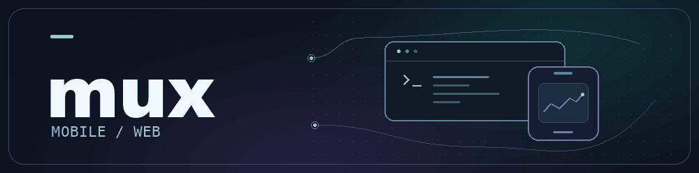
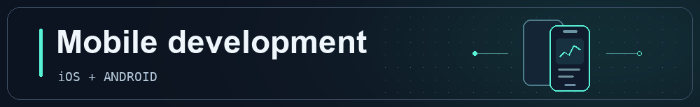
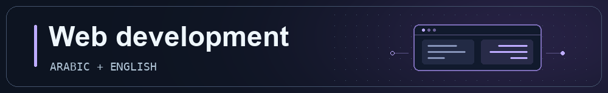

<h1>
  <picture>
    <source media="(prefers-reduced-motion: reduce)" srcset="./assets/mux-banner.png">
    
  </picture>
</h1>

I’m mux, a software developer building apps for mobile and the web.

## 

I build **iOS and Android apps** from a shared Flutter and Dart codebase. My work includes using SQLite to store data on the device and connecting Flutter interfaces to native Android services.

## 

I build web apps with **TypeScript** and work on bilingual interfaces for Arabic and English. That includes adapting layouts and navigation to each language’s reading direction.

عنّي بالعربي

- **الموبايل** — بطوّر تطبيقات لـ iOS وAndroid بـ Flutter وDart، وبستخدم SQLite لتخزين البيانات على الجهاز، وبربط واجهات Flutter بخدمات Android.
- **الويب** — بطوّر تطبيقات ويب بـ TypeScript، وبشتغل على واجهات بالعربي والإنجليزي بتراعي اتجاه القراءة في كل لغة.

